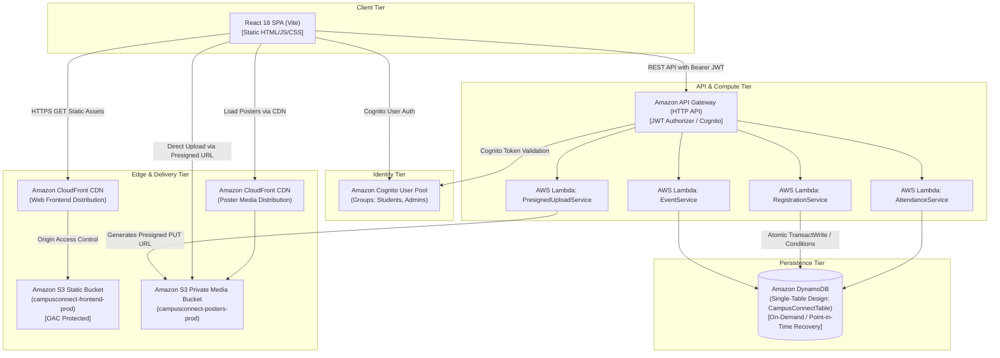

# CampusConnect — AWS Production Architecture Guide

This guide details the planned AWS Serverless cloud infrastructure for deploying **CampusConnect** to production.

---

## 1. Cloud Architecture Overview



---

## 2. Amazon DynamoDB Schema (Single-Table Design)

The database utilizes a single DynamoDB table named `CampusConnectTable` with partition key `PK` and sort key `SK`.

### Primary Access Patterns

| Entity | PK (Partition Key) | SK (Sort Key) | GSI1PK | GSI1SK | Attributes |
|---|---|---|---|---|---|
| **Event** | `EVENT#{eventId}` | `METADATA` | `STATUS#{status}` | `DATE#{eventDate}` | `title`, `category`, `venue`, `maxParticipants`, `registeredCount`, `posterUrl`, etc. |
| **Registration** | `EVENT#{eventId}` | `REG#{studentId}` | `STUDENT#{studentId}` | `DATE#{registeredAt}` | `ticketCode`, `status`, `attendance`, `studentName`, `studentEmail`, `studentRegNo` |
| **Ticket Lookup** | `TICKET#{ticketCode}` | `REF` | — | — | `eventId`, `studentId`, `registrationId` |
| **User Profile** | `USER#{userId}` | `PROFILE` | `ROLE#{role}` | `DEPT#{department}` | `name`, `email`, `role`, `studentId`, `department` |

### Atomic Capacity and Duplicate Prevention (Safeguards)

#### 1. Duplicate Registration Prevention
In the `RegistrationService` Lambda handler, registration requests perform a conditional write:
```python
dynamodb.put_item(
    TableName='CampusConnectTable',
    Item={
        'PK': {'S': f'EVENT#{event_id}'},
        'SK': {'S': f'REG#{student_id}'},
        # ... additional registration fields
    },
    ConditionExpression='attribute_not_exists(PK) AND attribute_not_exists(SK)'
)
```
If the student has already registered, DynamoDB returns `ConditionalCheckFailedException`, strictly preventing duplicate registration without race conditions.

#### 2. Atomic Capacity Increment
Event capacity is bounded using an atomic update with conditional expression:
```python
dynamodb.update_item(
    TableName='CampusConnectTable',
    Key={
        'PK': {'S': f'EVENT#{event_id}'},
        'SK': {'S': 'METADATA'}
    },
    UpdateExpression='SET registeredCount = registeredCount + :one',
    ConditionExpression='registeredCount < maxParticipants',
    ExpressionAttributeValues={':one': {'N': '1'}}
)
```
If concurrent requests attempt to register when `registeredCount == maxParticipants`, the operation fails safely, eliminating overbooking.

---

## 3. Secure Amazon S3 Uploads (Presigned URLs)

1. **Private S3 Bucket**: `campusconnect-posters-prod` with Block Public Access enabled on the bucket.
2. **Lambda Pre-signer**:
   ```javascript
   import { S3Client, PutObjectCommand } from "@aws-sdk/client-s3";
   import { getSignedUrl } from "@aws-sdk/s3-request-presigner";

   const s3 = new S3Client({ region: process.env.AWS_REGION });
   const command = new PutObjectCommand({
     Bucket: process.env.POSTER_BUCKET_NAME,
     Key: `posters/${uuidv4()}-${sanitizedFileName}`,
     ContentType: fileType
   });

   const uploadUrl = await getSignedUrl(s3, command, { expiresIn: 300 }); // 5 minutes
   ```
3. **Frontend Upload**: React makes a native `PUT` request directly to `uploadUrl`.
4. **CloudFront Delivery**: Posters are cached and served publicly through Amazon CloudFront via Origin Access Control (OAC), keeping the raw S3 bucket entirely private.

---

## 4. Amazon Cognito User Pool Configuration

- **User Pool Name**: `CampusConnectUserPool`
- **Attributes**:
  - `email` (Required, auto-verified via email code)
  - `name` (Required)
  - `custom:student_id` (String)
  - `custom:department` (String)
- **User Groups**:
  - `Admins`: Granted administrative permissions.
  - `Students`: Default standard permissions.
- **App Client**: `CampusConnectWebClient` (Public client without client secret).
- **Security**: MFA optional/required for Admin accounts; SRP authentication flow.

---

## 5. IAM Execution Roles & Least Privilege

### Lambda Execution Role (`CampusConnectLambdaRole`)
```json
{
  "Version": "2012-10-17",
  "Statement": [
    {
      "Effect": "Allow",
      "Action": [
        "dynamodb:GetItem",
        "dynamodb:PutItem",
        "dynamodb:UpdateItem",
        "dynamodb:DeleteItem",
        "dynamodb:Query"
      ],
      "Resource": [
        "arn:aws:dynamodb:*:*:table/CampusConnectTable",
        "arn:aws:dynamodb:*:*:table/CampusConnectTable/index/*"
      ]
    },
    {
      "Effect": "Allow",
      "Action": ["s3:PutObject"],
      "Resource": "arn:aws:s3:::campusconnect-posters-prod/posters/*"
    },
    {
      "Effect": "Allow",
      "Action": [
        "logs:CreateLogGroup",
        "logs:CreateLogStream",
        "logs:PutLogEvents"
      ],
      "Resource": "arn:aws:logs:*:*:*"
    }
  ]
}
```

---

## 6. Demo vs AWS Production Functionality Matrix

| Function / Workflow | Demo Mode (`VITE_USE_MOCK_DATA=true`) | AWS Production Mode (`VITE_USE_MOCK_DATA=false`) |
|---|---|---|
| **User Authentication** | Isolated in-memory/localStorage credentials; 1-click student/admin switcher | Amazon Cognito User Pool with JWT token validation |
| **Role Authorization** | React route guard checking demo user role attribute | API Gateway Cognito Authorizer + Lambda evaluating `cognito:groups` |
| **Event Persistence** | Stored in browser `localStorage` (`campusconnect_demo_store_v1`) | Amazon DynamoDB `CampusConnectTable` (Multi-AZ replicated) |
| **Duplicate Check** | JavaScript array filter checking existing student registrations | DynamoDB conditional `attribute_not_exists` expression |
| **Capacity Enforcement** | Clamped in JS memory before updating event registeredCount | Atomic DynamoDB `ConditionExpression: registeredCount < maxParticipants` |
| **Poster Upload** | Client-side Object URL preview (`URL.createObjectURL(file)`) | Secure Amazon S3 presigned PUT URL direct upload |
| **Ticket Verification** | Local deterministic QR pattern & client code lookup | Lambda cryptographic signature verification & DynamoDB update |
| **CSV Export** | Client-generated Blob download from local browser records | API generated CSV or direct browser download of verified records |
